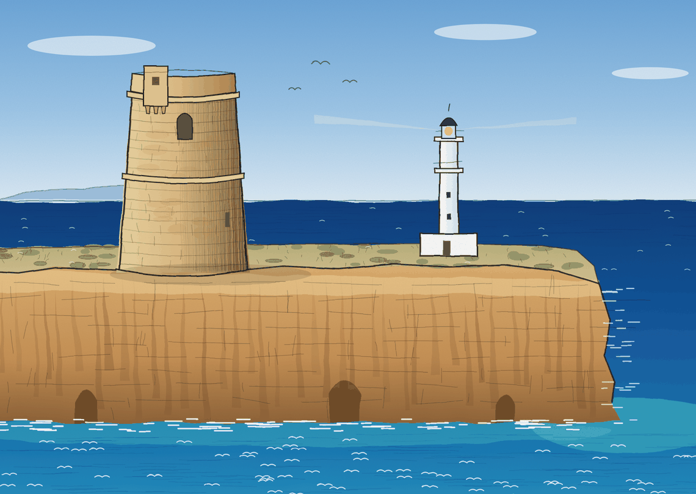

# Talaia · Resultats en l'alumnat

Prototip d'instrument de la **família 6 (resultats en l'alumnat)** de **Talaia**, el sistema compartit d'avaluació d'efectes de la formació permanent del professorat de les Illes Balears. Llegeix les dades de l'alumnat amb el **nivell 5 de Guskey**: recull indicadors al llarg dels cursos, hi hagi una formació concreta darrere o no, i diu quin nivell d'evidència de millora hi ha.

Elaborat pel **grup 6** a la sessió del Servei de Formació Permanent del Professorat del 30 d'octubre de 2026. Publicat per Carmen Moles, directora del CEP de Formentera.

**Obrir l'eina:** https://cepformentera.github.io/instrument-resultats-alumnat/ (un cop activat GitHub Pages).

## Què conté

| Pantalla | Què hi ha |
|---|---|
| Com s'usa | Qui l'usa, quant de temps, quan (moments 01, 04, 05 o seguiment del centre), què cal tenir a mà i on és dins Talaia |
| Per què és així | Les decisions del grup, cadascuna amb la cita de la font (Guskey, Servei, acords del grup, RGPD). Es pot descarregar per imprimir |
| 1. Objectiu | Canvi que es vol veure a l'alumnat, centre, vincle (una formació, diverses, un pla de centre o cap) i moment |
| 2. Indicadors | Tres dominis de Guskey: aprenentatge, actituds i benestar, conducta i trajectòria. Dades internes, externes i qüestionaris |
| 3. Dades | Un valor per curs des del punt de partida, tants cursos com calgui, i una referència per comparar |
| 4. Context | Evidència d'aplicació a l'aula (N4, família 5) i de suport del centre (N3, família 4), altres factors i resultats no buscats |
| 5. Conclusió | Nivell d'evidència calculat, decisió i ús de les dades per decidir (D4) |
| Informe | Amb logos, gràfics, nivell d'evidència i recomanacions. En Word (amb números de pàgina), per imprimir o com a text |

## Decisions principals

1. **Es comença pel resultat en l'alumnat.** Guskey (2002) demana planificar al revés, des dels resultats.
2. **L'eina gira entorn de l'indicador, no d'una formació**, i es pot emplenar anys després: els efectes poden tardar dos o tres anys (Guskey, 2005-06).
3. **Dades internes i externes**, com demanen les instruccions del grup 6 del Servei. Els registres del centre en són la font principal (Guskey, 2002).
4. **Tres dominis i diverses mesures** (Guskey, 2002).
5. **Sí als qüestionaris a l'alumnat i a les famílies** per al domini afectiu, sempre el mateix qüestionari, anònim i agregat (Guskey, 2002).
6. **No es repeteixen les famílies 4 i 5**: s'hi enllaça. Totes les famílies han d'estar orientades a resultats d'alumnat, docents i centre (instruccions del Servei).
7. **Evidència, no prova** (Guskey, 2005-06), amb punt de partida, sèrie, comparació i més d'una mesura.
8. **Resultats no buscats** (Guskey, 2002).
9. **Nivell d'evidència** (feble, moderada, forta): proposta del grup per debatre, no és de Guskey ni del Servei.
10. **Fora: la satisfacció amb la formació** (N1 i N2), que té els seus instruments.

## Fonts

- Guskey, T. R. (2002). Does It Make a Difference? Evaluating Professional Development. *Educational Leadership*, 59(6). ASCD. https://ascd.org/el/articles/does-it-make-a-difference-evaluating-professional-development
- Guskey, T. R. (2005-2006). A Conversation With Thomas R. Guskey. *The Evaluation Exchange*, XI(4). Harvard Family Research Project. https://archive.globalfrp.org/evaluation/the_evaluation_exchange/issue_archive/professional_development/a_conversation_with_thomas_r_guskey
- Learning Forward. Guskey's Five Critical Levels of Professional Development Evaluation. https://learningforward.org/wp-content/uploads/2014/05/guskey-5-levels.pdf
- Servei de Formació Permanent del Professorat. *Grup 6. Família d'instruments de resultats en l'alumnat. Instruccions*. Sessió del 30 d'octubre de 2026.
- Servei de Formació Permanent del Professorat. *Avaluació dels efectes de la formació permanent del professorat: Talaia*. Sessió del 30 d'octubre de 2026, amb el resum del treball del curs 2025-26 a càrrec de Glòria Soler.

## Protecció de dades

- **Només dades agregades**: recomptes, mitjanes i percentatges. Cap nom, document d'identitat, data de naixement, imatge ni cap altra dada que permeti identificar un alumne o un docent.
- **Grups petits**: en grups reduïts una mitjana pot identificar una persona. Recomanam no donar dades de grups de menys de 10 alumnes i agrupar-les per cicle, etapa o diversos cursos. Aquest llindar és una recomanació de bona pràctica, no una xifra legal.
- **Camps de text**: no hi escriviu noms ni casos concrets.
- **Dades especialment protegides** (salut, necessitats educatives, expedients disciplinaris): només com a recompte global, mai individualitzades.
- **Dades externes** (IAQSE, PAU): només resultats agregats publicats o facilitats per canals oficials.
- **On es guarda**: l'eina no envia res a cap servidor. Guarda un esborrany només al navegador del dispositiu (`localStorage`). En un ordinador compartit, pitjau «Començar de nou» en acabar. La versió nova usa un esborrany diferent de l'anterior.
- **Marc normatiu**: les dades realment anònimes queden fora de l'àmbit del RGPD ([considerand 26](https://gdpr-text.com/es/read/recital-26)). Si en algun cas no ho són, s'aplica:
  - Reglament (UE) 2016/679 del Parlament Europeu i del Consell, de 27 d'abril de 2016 (RGPD), DOUE L 119, de 4 de maig de 2016.
  - Llei orgànica 3/2018, de 5 de desembre, de protecció de dades personals i garantia dels drets digitals, BOE núm. 294, de 6 de desembre de 2018.
  - Llei orgànica 2/2006, de 3 de maig, d'educació, disposició addicional vint-i-tresena (dades personals dels alumnes), BOE núm. 106, de 4 de maig de 2006, en la versió consolidada vigent.

  En cas de dubte, consultau la persona delegada de protecció de dades de la Conselleria d'Educació.

## Adaptar-lo

És un sol fitxer (`index.html`). Carrega de CDN les tipografies (Google Fonts), les icones (Phosphor) i, només en descarregar el Word, la llibreria `docx`. Els camps marcats **Camp mínim** són una proposta del grup: s'han d'ajustar a la llista definitiva del Servei.

## Il·lustració de Talaia

Il·lustració a llapis i aquarel·la de la Torre des Garroveret, la talaia del Cap de Barbaria, amb el far des Cap de Barbaria i la mar Mediterrània al fons. Proposada com a símbol de Talaia. Concepte i direcció: Carmen Moles, CEP de Formentera, 2026. No és un logotip oficial del Servei. Llicència CC BY-NC 4.0.

## Llicència

[Creative Commons Reconeixement-NoComercial 4.0 Internacional (CC BY-NC 4.0)](https://creativecommons.org/licenses/by-nc/4.0/deed.ca). Podeu usar, copiar i adaptar aquest material citant l'autoria, sense finalitat comercial. Vegeu [LICENSE](LICENSE).
